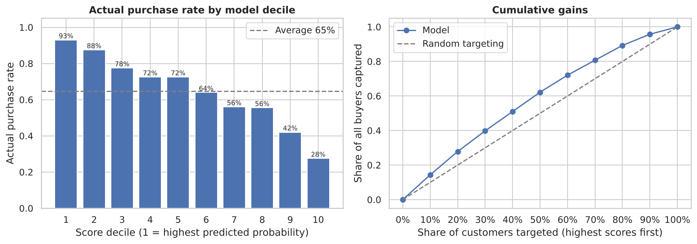
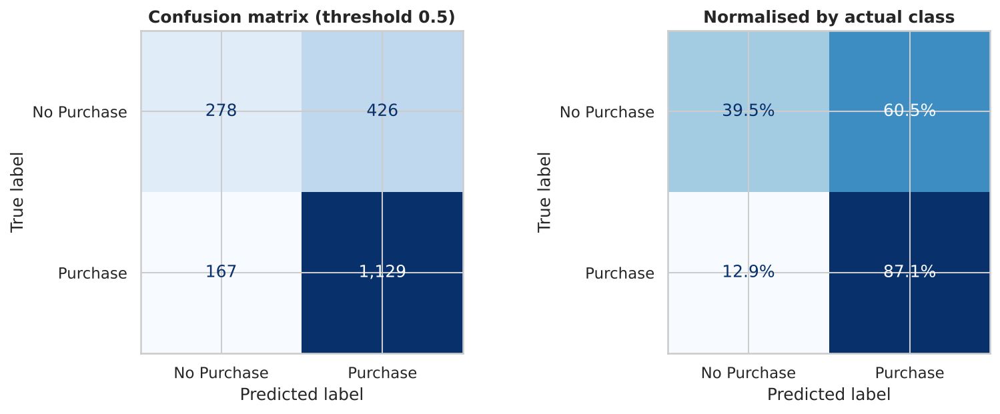
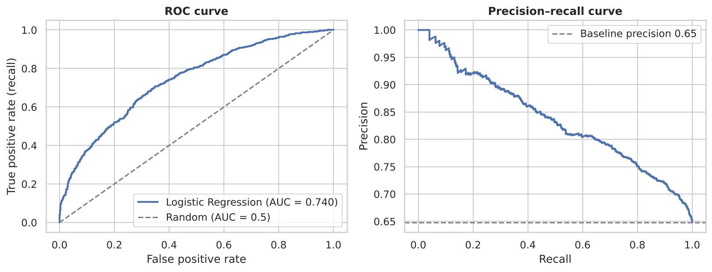
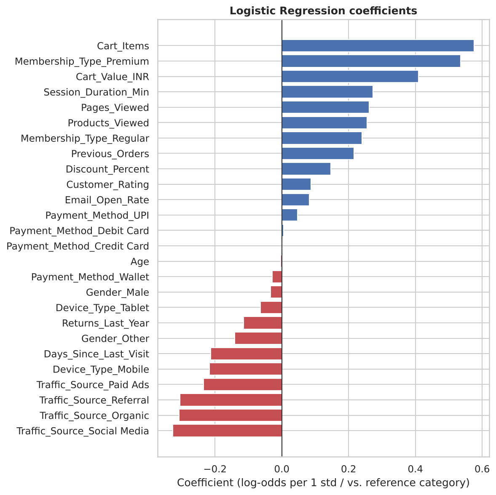

# ShopSmart — E-Commerce Customer Purchase Prediction

Predicting whether an online shopper will complete a purchase, using **Logistic Regression** on 10,000 customer sessions.

  

## Problem statement

ShopSmart cannot tell which visitors are likely to buy and which will leave without purchasing. This project builds a supervised binary classifier that predicts `Purchase` (**0 = No Purchase**, **1 = Purchase**) from customer demographics, browsing behaviour, cart details and purchase history. It then turns the predictions into customer segments that marketing can act on.

| | |
|---|---|
| **Domain** | E-Commerce |
| **Learning type** | Supervised, binary classification |
| **Algorithm** | Logistic Regression |
| **Dataset** | 10,000 customers × 19 columns (12 numeric, 5 categorical, ID, target) |
| **Evaluation** | Accuracy, Precision, Recall, F1-score, Confusion Matrix, ROC-AUC |

## Results

Held-out test set of 2,000 customers (stratified 80/20 split):

| Model | Accuracy | Precision | Recall | F1 | ROC-AUC |
|---|---|---|---|---|---|
| Baseline (always predict Purchase) | 0.648 | 0.648 | 1.000 | 0.786 | 0.500 |
| **Logistic Regression (tuned: L1, C = 1)** | **0.704** | **0.726** | **0.871** | **0.792** | **0.740** |

* 5-fold cross-validated ROC-AUC: **0.727 ± 0.008**. Train and validation scores are almost identical, so the model is not overfitting.
* A gradient-boosting benchmark reached test AUC 0.726. It did not beat Logistic Regression, so the simpler, interpretable model was kept.
* The model **ranks customers well**: the top-scoring 10% bought at **93%**, compared with **28%** for the bottom 10%.

<p align="center">
  
</p>

<p align="center">
  
  
</p>

## What drives a purchase

<p align="center">
  
</p>

| Raises purchase odds | Lowers purchase odds | No real effect |
|---|---|---|
| Cart items (×1.78 per std) | Traffic from Social Media / Organic / Referral vs Email (×0.72–0.74) | Age |
| Premium membership (×1.71 vs New) | Mobile vs Desktop (×0.81) | Gender |
| Cart value (×1.51) | Days since last visit (×0.81) | Payment method |
| Session duration, pages viewed, products viewed (×1.29–1.31) | Returns last year (×0.89) | |
| Previous orders (×1.24) | | |

## Approach

1. **EDA:** target balance, missing-value audit, distributions, IQR outlier audit, purchase rate by every feature, and a correlation and multicollinearity check.
2. **Preprocessing** (one scikit-learn `Pipeline`, fitted on training data only, so there is no leakage):
   * Missing values: median for numeric columns, mode for categorical columns (about 22% of rows had at least one gap).
   * Outliers: capped at Q1 − 1.5·IQR and Q3 + 1.5·IQR. This raised CV AUC from 0.704 to 0.729.
   * Encoding: one-hot, first level dropped.
   * Scaling: `StandardScaler`.
3. **Modelling:** majority-class baseline, then default Logistic Regression, then a grid search over `C`, L1/L2 and `class_weight` with stratified 5-fold CV.
4. **Evaluation:** classification report, confusion matrix, ROC and PR curves, calibration, threshold trade-off, and lift/gains.
5. **Interpretation:** coefficients and odds ratios.
6. **Deployment:** saved pipeline, out-of-fold scores for all customers, and a CLI to score new customers.

## Customer segments

| Segment | Score | Share | Actual purchase rate | Suggested action |
|---|---|---|---|---|
| High intent | ≥ 0.75 | 35% | 84% | Keep checkout friction-free; no discount needed |
| Medium intent | 0.55–0.75 | 34% | 65% | Recommendations, social proof, free-shipping threshold |
| Low intent / at risk | < 0.55 | 30% | 43% | Cart-abandonment reminders, targeted offers |

Pick the decision threshold by use case: **0.50** for general use (best accuracy), **0.60** to balance both classes (best macro-F1), and **0.75** for a short, high-confidence list of buyers.

## Repository structure

```
shopsmart-purchase-prediction/
├── data/
│   ├── ecommerce_purchase_data.csv          # source dataset (10,000 customers)
│   └── sample_new_customers.csv             # example input for scoring
├── notebooks/
│   └── shopsmart_purchase_prediction.ipynb  # full analysis, executed with outputs
├── src/
│   ├── __init__.py
│   ├── preprocessing.py                     # imputation, IQR capping, encoding, scaling, model pipeline
│   └── predict.py                           # score new customers from a CSV
├── models/
│   └── logistic_regression_purchase_model.joblib
├── outputs/
│   ├── customer_purchase_scores.csv         # out-of-fold probability + segment for all customers
│   ├── sample_new_customer_predictions.csv
│   ├── model_comparison.csv
│   ├── model_coefficients.csv
│   └── threshold_analysis.csv
├── reports/
│   ├── shopsmart_purchase_prediction_report.pdf
│   ├── shopsmart_purchase_prediction_notebook.html
│   └── figures/                             # 16 charts
├── requirements.txt
└── README.md
```

## How to run

```bash
git clone https://github.com/<your-username>/shopsmart-purchase-prediction.git
cd shopsmart-purchase-prediction
pip install -r requirements.txt

# Reproduce the full analysis (regenerates models/, outputs/ and reports/figures/)
jupyter notebook notebooks/shopsmart_purchase_prediction.ipynb

# Score new customers (run from the repo root)
python -m src.predict data/sample_new_customers.csv outputs/predictions.csv
python -m src.predict data/sample_new_customers.csv outputs/predictions.csv --threshold 0.6
```

The input CSV needs the 17 feature columns of the training data. `Customer_ID` is optional, and missing values are handled by the pipeline.

## Business recommendations

1. Score every live session and act by segment.
2. Push customers to add products to the cart (wish-list prompts, bundles, "frequently bought together"). Cart items are the strongest lever.
3. Invest in the Email channel and in re-engaging lapsed visitors.
4. Review the mobile experience. Mobile is 61% of traffic, and mobile users convert less than desktop users even when their browsing and cart behaviour is similar.
5. Grow Premium membership. Premium customers convert 11 points higher than New customers.
6. Investigate products with high return rates. Customers with more returns buy less.

**Limitations:** the model misclassifies about 30% of test customers. The data lacks some likely drivers, such as price competitiveness, stock and delivery dates. The coefficients show associations, not causes, so validate the recommendations with A/B tests.
